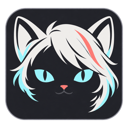
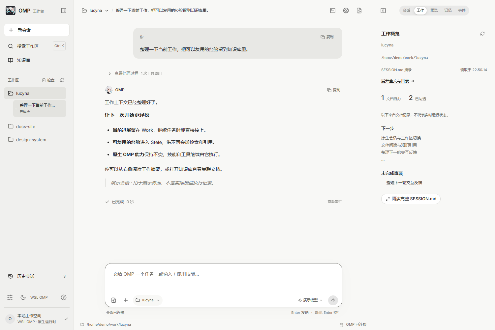
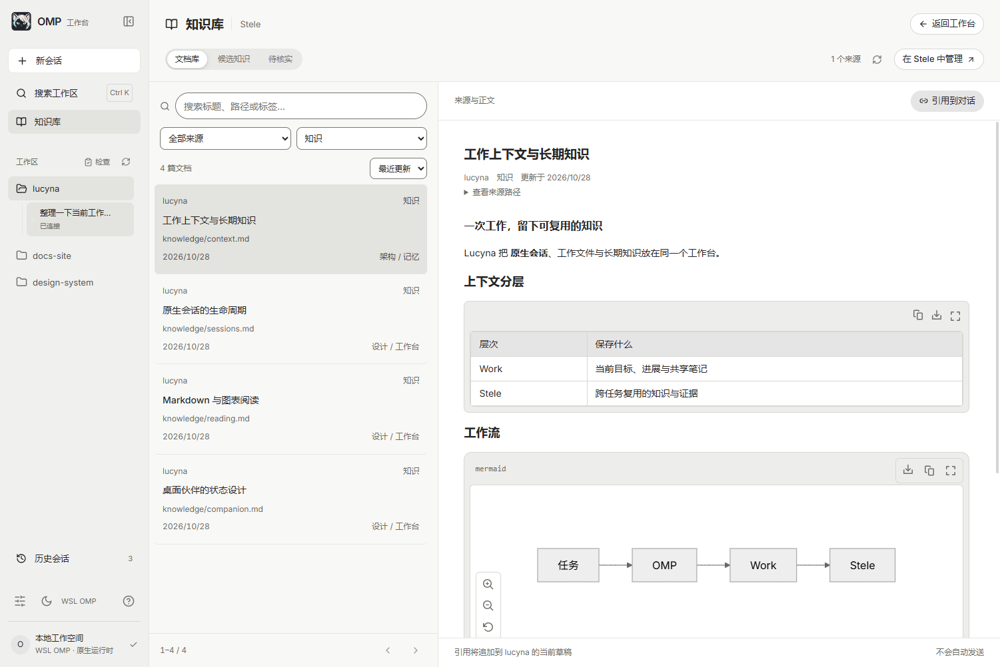
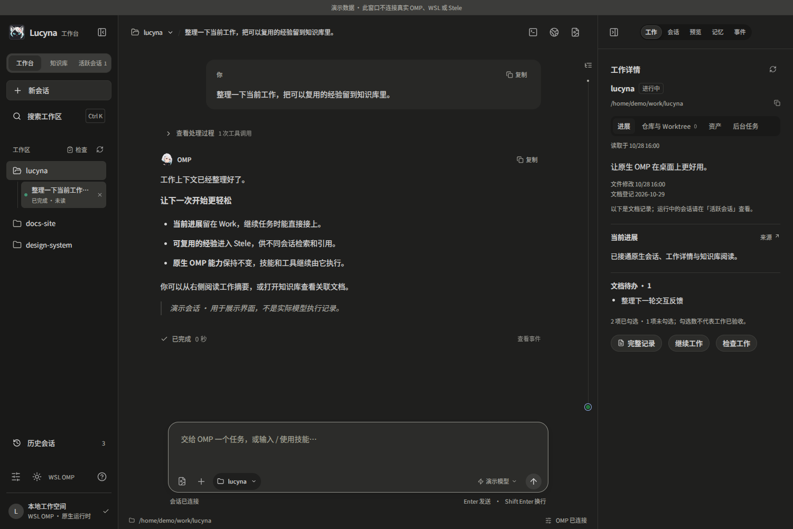
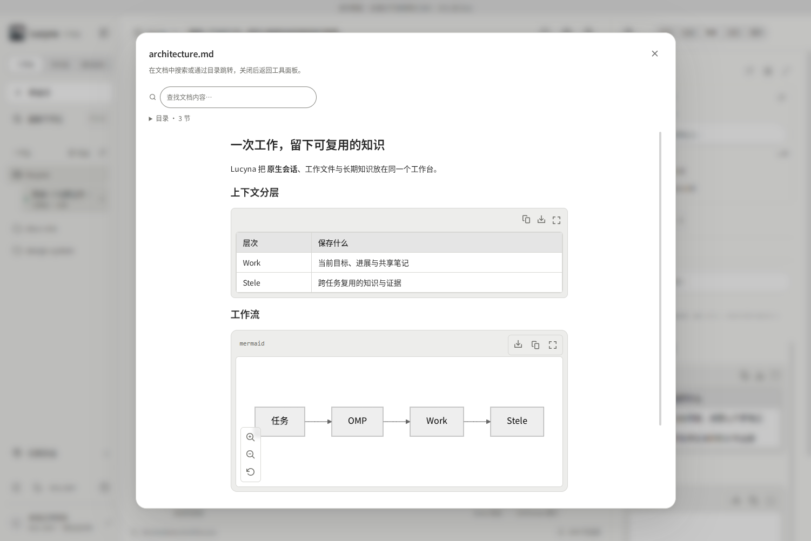
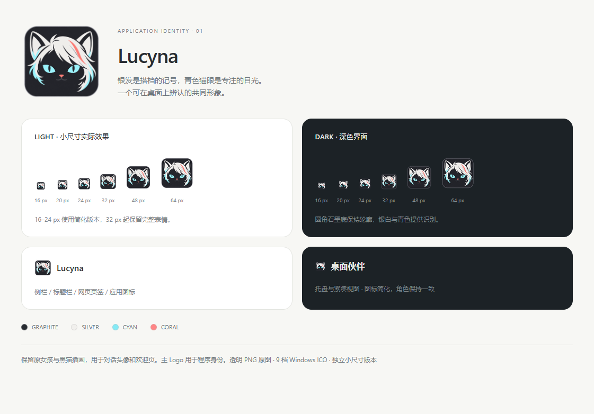

<div align="center">
  
  <h1>Lucyna</h1>
  <p><strong>让原生 OMP，拥有一个桌面工作台。</strong></p>
  <p>A Windows desktop workbench for native OMP, WSL workspaces and lasting knowledge.</p>
  <p><a href="docs/getting-started.md">快速开始</a> · <a href="docs/features.md">功能列表</a> · <a href="docs/architecture.md">架构</a> · <a href="docs/development.md">开发</a></p>
</div>



Lucyna 是一个围绕 [oh-my-pi / OMP](https://github.com/can1357/oh-my-pi) 的 Windows 桌面客户端：用可视化界面管理工作区、并行会话、终端、文件阅读和知识引用。模型、agent loop、技能、工具调用和 session 仍由 **原生 OMP** 执行。

界面借鉴 [Cindy](https://github.com/makecindy/cindy)，复用部分带许可证的 UI 组件；Work 承载当前工作上下文，Stele 承载 L3 长期知识。银发女孩与黑猫是 Lucyna 的视觉伙伴，也可以作为桌面像素宠物陪伴工作。

> 当前为 **早期源码版本**，主要面向 Windows 11 + WSL2。展示名为 Lucyna，内部包名保留 `omp-cindy` 以兼容现有数据目录。截图由真实生产界面渲染，所有工作、会话和知识内容均为演示数据，不代表真实模型执行记录。

## 可以做什么

| 场景 | 能力 |
| --- | --- |
| 多个工作同时推进 | 多 work / 多 session 并行，切换保留任务、草稿、终端和状态 |
| 使用自己的 OMP | WSL / Windows 运行时切换，原生配置、技能补全、模型选择、交互提问与停止 |
| 接着之前的任务做 | 历史搜索、会话导入副本、续聊和原生 journal 归属校验 |
| 在上下文中阅读 | 文件列表、Markdown/GFM、语法高亮、公式、Mermaid、图片和网页预览 |
| 留下长期知识 | Stele 文档、来源与标签筛选、关联阅读、候选知识、待核实、引用到草稿 |
| 看清任务状态 | 工具过程、事件、只读工作区诊断；登记偏差不会阻断阅读与终端 |
| 桌面上有个伙伴 | 两种外观、四种动画状态、32 帧像素素材、置顶、托盘、状态提示和隐私设置 |

完整范围和限制见 [功能与当前边界](docs/features.md)。客户端需要保持运行才能维持后台会话；Work 技能与 Stele 服务需单独准备。

## 界面一览

### 知识库

从文档、来源与标签找到信息，阅读关联知识，并引用到当前会话。



### 深色工作台



### 文件与 Markdown

文件列表和阅读器共享工作上下文；代码、表格、公式与图表使用开源渲染引擎。



### 应用图标与桌面伙伴

<p>
  
</p>

<p>
  
  
</p>

上方为静态素材展示；客户端使用逐帧动画响应空闲、工作、等待输入和完成状态。运行 `npm run pet:preview` 可查看动画。

## 开始使用

先准备 Windows Node.js **22.12+**、WSL2、WSL 内的 Python 3.10+ / Git 和已能正常对话的 OMP。当前协议基线为 OMP **18.13.1**。

```powershell
git clone https://github.com/sudashannon/lucyna.git
cd lucyna
npm ci
Copy-Item runtime.example.json runtime.local.json
# 编辑 runtime.local.json，填写自己的 WSL 用户、workRoot 和 OMP 路径
npm start
```

`runtime.local.json` 不上传 Git。模型凭证继续放在原生 OMP profile。客户端设置页可切换 OMP 运行时和模型；WSL 的发行版、用户和工作根在本地 JSON 中配置。

**首次使用请看 [完整安装与配置指南](docs/getting-started.md)**，包括最小 demo work、历史存储、Windows 模式、可选 Work/Stele 集成和回退。当前仓库不提供一键安装包，也不随源码分发个人技能、会话、认证或 Stele 服务。

## 原生能力与客户端的分工

```text
React 工作台 ── 受限 IPC ── Electron 会话管理 ── 原生 RPC ── OMP
     │                           │                         │
文件 / 知识 / 事件             WSL 终端                  技能 / 工具
                                 │                         │
                              Work 上下文 ←── MCP ──→ Stele L3
```

Lucyna 负责交互、进程路由和可视化；OMP 负责执行。详见 [架构说明](docs/architecture.md)。

## 开发与验证

```powershell
npm test
npm run typecheck
npm run build
npm run test:renderer
npm run test:pet:animation
npm run screenshots
```

默认测试使用临时 profile 与合成数据，不调用付费模型，不改真实 work。Python 工作区测试、源文件导航及截图复现方式见 [开发文档](docs/development.md)。欢迎提交 [问题](https://github.com/sudashannon/lucyna/issues) 和改进，参见 [CONTRIBUTING.md](CONTRIBUTING.md)。

## 来源与许可

Cindy 组件保留原始 **Apache-2.0** 许可、NOTICE 与来源记录，见 [第三方署名](THIRD_PARTY_NOTICES.md)。OMP 是用户单独安装的原生运行时。本项目自己的许可证尚待维护者选择；源码公开不代表自动授予第三方代码之外的使用或再分发许可。

模型配置、用户 session、私人 Work 内容与本机验收日志不属于仓库。报告问题前请阅读 [安全与本地数据说明](SECURITY.md)。
