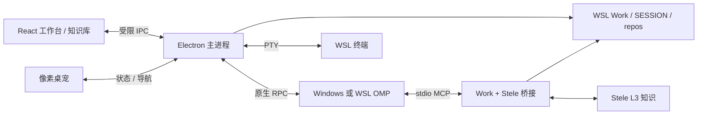

# 架构

Lucyna 提供 UI 和进程路由；OMP 保留模型、工具、技能和会话循环。Work 与 Stele 负责不同层次的上下文。

- `src/session-manager.cjs` 管理每个 session 的原生进程所有权；界面切换不等于终止任务。
- `src/history.cjs` 处理历史来源、cwd 归属和导入副本，避免跨 work 错续或双写。
- `src/backend.cjs` 与 `src/work-inventory.py` 提供只读工作区诊断；警告与不可恢复的路径错误分别显示。
- `src/renderer/` 是 React 界面；`vendor/cindy` 是保留许可证的 Cindy UI 组件。Markdown 采用 Streamdown 及 code、math、mermaid、cjk 插件。
- `src/pet/` 管理独立透明窗口、状态聚合和动画，不运行另一套 agent。
- `tools/work-stele/server.py` 是受限的 stdio MCP 桥接；可用工具来自 allowlist，凭证留在 WSL。
- `src/runtime-config.cjs` 与 `tools/runtime_config.py` 读取本地机器配置。公共代码不依赖开发者用户名或 provider 认证。

客户端现有存储命名继续使用 `omp-cindy`，项目展示名为 Lucyna。这样更名不会强制搬迁既有设置与会话副本。
