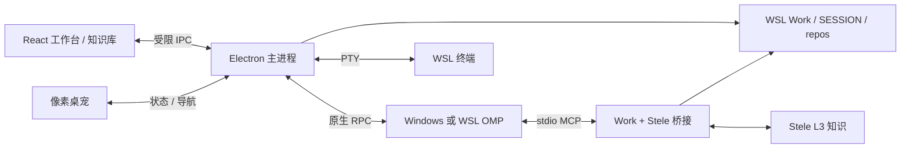

# 架构

Lucyna 提供 UI 和进程路由；OMP 保留模型、工具、技能和会话循环。Work 与 Stele 负责不同层次的上下文。

客户端辅助任务由独立的 Vercel AI SDK `ToolLoopAgent` 执行。`auxiliary-settings.cjs` 管理协议、地址、模型、超时和加密密钥；只有主进程读取密钥。`auxiliary-agent.cjs` 显式连接用户配置的 Chat Completions 或 Responses 服务，单步、无工具、无自动网络重试；Responses 请求关闭服务端存储。它不创建 OMP 会话，也不向主对话追加命名提示。原生任务执行仍由 OMP 管理。

`session-titles.cjs` 在有效任务回复结束后为无标题会话生成名称。写回前后绑定同一客户端连接、原生日志和会话 ID，并检查配置版本、运行状态和当前名称；新 prompt、改名、关闭或配置变化使迟到结果失效。通过原生 `set_session_name` 保存标题，按 RPC 语义标记为 `source:user`，成功后保留；界面与桌宠通过 `session_info_update` 同步。失败保留消息摘要，同一连接最多尝试两次，重试等待后续有效轮次。恢复历史本身不会触发生成。

- `src/session-manager.cjs` 管理每个 session 的原生进程所有权；界面切换不等于终止任务。
- 会话启动从后台任务检查开始统一限时 60 秒；渲染器另对连接和历史恢复限时 75 秒。关闭或超时会取消准备并释放 Work 启动锁，延迟返回的旧请求不得启动 OMP；工作区扫描即使遇到 WSL 管道不关闭，也在 45 秒后返回错误。
- `src/history.cjs` 处理历史来源、cwd 归属和导入副本，避免跨 work 错续或双写。
- `src/wsl-session-history.cjs` 校验配置的原生目录、真实文件路径及 journal 的 cwd，允许已有 WSL 历史原地续聊。Windows 仅登记 `wsl-session-links` 路径索引；显式复制或跨运行时迁移才调用 OMP 原生 pack/unpack。前端按实际 journal 路径识别连接，副本的来源路径不作为写入者身份。
- 新导入副本首次启动使用原生 `--fork` 获取独立 ID，防止与原件争用 OMP 按 ID 管理的写入锁；成功后原子更新导入元数据，后续使用 `--resume`。旧副本不自动重写。原地续聊的启动状态必须返回所选文件，否则显示错误并结束该次连接，保留草稿。
- `src/backend.cjs` 与 `src/work-inventory.py` 提供只读工作区诊断；警告与不可恢复的路径错误分别显示。
- `src/renderer/` 是 React 界面；`vendor/cindy` 是保留许可证的 Cindy UI 组件。Markdown 采用 Streamdown 及 code、math、mermaid、cjk 插件。
- `src/pet/` 管理独立透明窗口、状态聚合和动画，不运行另一套 agent。
- `tools/work-stele/server.py` 是受限的 stdio MCP 桥接；可用工具来自 allowlist，凭证留在 WSL。
- `src/knowledge-service.cjs` 将固定 IPC 操作映射到本地 Stele API。渲染器不能指定任意 URL 或 HTTP 方法；上传采用限额 multipart，编辑携带强 ETag，候选/复核携带输入版本。问答通过受限 IPC 转发真实 SSE，提前结束不作为成功。
- `KnowledgeWorkspace` 复用原有文档阅读器，提供探索、来源、维护和工具视图。Cytoscape 按需加载并使用 Stele 返回的社区和关系数据，默认折叠社区，会话节点按需显示；知识仍由 Stele 管理。
- `src/runtime-config.cjs` 与 `tools/runtime_config.py` 读取本地机器配置。公共代码不依赖开发者用户名或 provider 认证。

产品名称为 Lucyna，包名为 `lucyna`。`src/app-identity.cjs` 显式固定兼容数据目录 `omp-cindy`，使 Electron 的 `userData` 与 `sessionData` 保持一致；设置、会话副本、IndexedDB 草稿与窗口状态继续使用原位置。独立测试可设置 `LUCYNA_USERDATA`，旧的 `OMP_CINDY_USERDATA` 也继续兼容。
