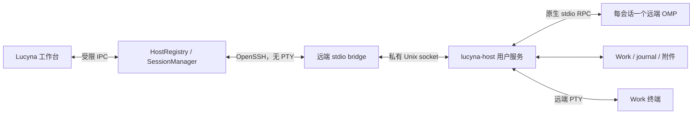

# SSH 主机与 lucyna-host：自动部署设计

更新：2026-10-31。状态：Linux x86_64 frozen 自动安装、无系统 Python/无公网安装、正式 SSH 设置和远端 OMP 工作台已接通；真实 OpenSSH 与两个独立 Electron 进程验证了安装、错误重试、提问、丢确认核对和同进程恢复。当前远端工作台提供配置目录、SESSION.md 和受管历史，完整文件/终端/Work 管理及发布矩阵未完成。下文保留完整目标契约，实际范围以 [review 记录](ssh-host-review.md) 为准，交付顺序见 [开发计划](ssh-host-implementation-plan.md)。

继续复用 OpenSSH/systemd，已采用 PyInstaller onedir 预构建 host 包来消除远端 Python 前提；Herdr、Distant 等不直接替换原生 OMP RPC。候选、源码依据和早期打包实验见 [复用评估](ssh-host-reuse-review.md)。

## 1. 用户目标与首版契约

配置可用的 SSH 连接后，Lucyna 自动检测、上传、安装并连接远端 `lucyna-host`。用户不需要手工下载 host、复制脚本、运行 pip 或配置服务。「保存并连接」包含部署该用户目录内 host 的意图，安装阶段不再重复确认。

正常流程：添加主机 → 检测 SSH → 自动准备远端组件 → 发现 OMP 与工作目录 → 进入远端 Work。各阶段可见、可取消；再次连接复用现有安装。新主机不改变本机现有会话的执行环境。

首版目标：Windows Lucyna → Linux SSH 服务端，包含开启 SSH 的 WSL；架构为 x86_64、aarch64、glibc。glibc 下限由选定的 frozen host/便携 Python 制品和验收矩阵决定，发布前固定。远端 Windows、macOS、Alpine/musl 暂不宣称支持。

自动部署的对象是 Lucyna host。OMP 沿用远端已有安装、profile、模型认证与工具。缺少 OMP 时仍可完成 host 安装，显示「需要配置 OMP」，不把安装成功当作模型已可用。Work 根使用已保存或用户选择的目录，不递归扫描整个 home 猜测工作区。

OMP 启动环境从远端用户的登录环境获取，只在远端进程内存中使用；捕获 shell 启动输出，不混入 RPC，也不回传环境变量。显式 profile/agentDir 配置必须消除歧义，不默认清空用户原生 profile，不继承 Windows 的模型认证或临时 SSH agent 环境来承诺离线可用。

必须区分：断线后接回原 OMP 进程、OMP 已退出后续聊原 journal、服务/主机重启后核对中断状态。只有第一种可以自动恢复连接，不能用自动重发任务实现后两种。

## 2. 代码边界

| 当前入口 | 当前行为 | 改动 |
| --- | --- | --- |
| `src/backend.cjs` | Windows/wsl.exe 子进程与 OMP stdio RPC；Work 固定走 WSL | 分离会话和传输，按 host 路由查询 |
| `src/client-settings.cjs`、`src/runtime-config.cjs` | 单个本机 WSL 配置、Windows/WSL 默认运行时 | 保留兼容配置，另建多主机配置 |
| `src/session-manager.cjs` | 依赖 child、日志文件和原生 ID | 加入 host/远端进程身份，拆分 detach/terminate |
| `src/history.cjs`、`src/wsl-session-history.cjs` | 本机/UNC 路径校验、原地续聊 | realpath、cwd、日志锁校验在远端执行 |
| `src/main.cjs`、`src/preload.cjs` | 多数 IPC 只传 root 字符串 | 使用含 host 的 locator，保持受限 IPC |
| `src/renderer/workbench-store.ts`、`src/renderer/history-entry.ts` | root、路径、runtime 参与索引/恢复 | 缓存、草稿、历史、未读与标题任务包含 host |
| `src/text-attachments.cjs` | 本机/WSL 写原生附件目录 | host 写入远端真实 journal 的附件目录 |
| `src/work-runner.cjs`、`tools/work-runner/` | 独立后台服务与可断开 bridge | 复用进程所有权/SQLite/安装思路；首版不迁移后台实验 |

Host 是执行与数据访问边界，SSH 是连接方法，OMP runtime 是引擎，不将三者合为 `runtime: ssh` 的分支。保留已有 Windows OMP 在 WSL Work 上执行的组合；SSH host 首版只在该远端 Work 上执行该远端 OMP。

远程接入不等于跨设备同步。远端 Work、journal、原生附件留在远端；桌面保存配置、定位、界面状态、草稿及有限缓存。Lucyna 自有存储/同步继续使用独立数据模型。

## 3. 架构与运行时



host 使用 Python 3.10+ 标准库，包括 asyncio、sqlite3、socket、fcntl、pty，复用现有 Python Work/RPC 经验。远端不要求 Node/npm/pip，host 不实现新的 agent loop。

默认部署路径现为 PyInstaller `onedir` 预构建 host 包，由桌面上传，目标机无需联网安装依赖；系统 Python 路径仅作为显式 `--source` 开发选项。已锁定构建依赖和制品摘要，x86_64 实测构建基线是 glibc 2.35。第二架构、完整许可证清单和桌面发行集成仍待完成；不替换系统 Python。`python-build-standalone` 保留为未来兼容性备选。

控制链使用系统 OpenSSH，复用 SSH config、known_hosts、agent、ProxyJump。默认 Windows OpenSSH，可显式选择 WSL 中的 OpenSSH；路径和身份配置始终由所选执行器解释。认证失败不静默切换执行器。

服务仅监听当前用户 Unix socket，通过 SSH 执行 bridge 访问，不新增网络端口。OMP/RPC 通道不分配 PTY；终端由 host 单独创建远端 PTY。

## 4. 配置与可见状态

设置的「运行与模型」组增加主机管理，工作列表显示来源主机。基础字段：名称、SSH 别名或地址/用户/端口、可选本地私钥引用、Work 根。OMP 路径/profile 放在高级项中并提供探测。

「保存并连接」自动部署；「检查连接」只做检测。首版自动连接支持密钥/agent 认证与 ProxyJump。首次主机身份确认和密钥解锁使用同一执行器的原生 SSH 交互入口，完成后继续安装。密码 askpass 后续提供，不能将不支持的认证方式显示为「SSH 已配置」。私钥内容、口令、OMP 凭证不保存到 hosts 配置。

| 状态 | 呈现和恢复 |
| --- | --- |
| connecting / needs_ssh_setup | 正在连接；需要确认身份/认证时打开原生 SSH 入口，配置保留 |
| probing | 正在检查远端环境；展示平台与结果，不回传环境变量 |
| transferring | 正在上传，展示已传/总字节；可取消并重新核对完整包 |
| installing / starting | 正在安装/启动；以实际协议握手作为就绪依据 |
| ready | 已连接；分别显示 OMP、Work 和保活能力 |
| needs_omp / needs_work_root | host 已就绪；修订对应字段，无需重装 |
| update_pending | 新版已准备，原有进程结束后更新；不强制重启 |
| reconnecting / offline | 保留内容和草稿；连接中断不等于任务失败/完成 |
| failed | 展示失败阶段和可读原因；重试从探测/事务核对继续 |

默认超时：连接 20 秒、探测 30 秒、安装/启动各 60 秒；上传为 30 秒无进度超时及 10 分钟总上限。安装在会话启动前完成，不借无限延长现有 60 秒启动限制掩盖安装进度。

取消只停止本次连接/部署。已完成的安装可复用，未激活的暂存待清理；关闭设置/退出桌面不卸载 host，也不结束远端 OMP。

## 5. 自动部署事务

host 包由桌面构建并随 Lucyna 分发。远端不依赖 GitHub/PyPI/下载站，不执行 curl-pipe-shell。源码开发模式先生成本地完整安装包，再走同一部署链。

1. 本地校验配置/随包 manifest，创建 installAttemptId；同主机并发连接共享安装任务。
2. 通过 SSH 执行固定 POSIX sh 探测脚本，返回有标记、有大小限制的结构化结果：系统、架构/glibc、UID/home、基础工具、已有安装及服务能力。shell 噪声不进入 JSON 或环境回传。
3. 探测不依赖 Python。首版基础条件为 POSIX sh、tar/gzip、sha256sum 和常见文件工具；不满足时报告支持条件，不自动 apt/sudo。
4. 按固定发行策略选择匹配的 frozen host 或源码/运行时包；源码路径必须检查 Python 版本/模块。平台、glibc 或制品不匹配，在上传前停止。
5. 在远端用户私有目录建立事务。路径必须属于该 UID，拒绝意外符号链接、非 Lucyna 同名安装或不受管理的同名 unit。
6. SSH stdin 上传制品；上传与执行分离，独立核对 manifest 中的长度和 SHA-256，半个包不得解包执行。
7. host/私有运行时包解到独立候选目录，再由对应安装入口校验 payload。打包阶段拒绝绝对/越界路径与越界链接；运行时必需链接也必须在包内。不得向可写既有目录盲目解 tar。
8. 校验文件 manifest，运行不连接 OMP/用户 Work 的自检。远端独占安装锁；已有相同 release 验证后复用，失败制品不标记完整。
9. 首装原子发布候选，写带所有权标记的用户 unit；更新按第 6 节的排空与兼容规则进行。
10. 当前用户权限内启动服务，核对真实 hello/ping、安装身份与 active release，成功后登记 lastKnownGood。
11. 建立 bridge，再单独检测 OMP 路径/版本及配置的 Work 根。安装成功和 OMP 环境可用分开报告。
12. 清理已完成事务，保留 current、lastKnownGood 和仍被进程引用的 release。断线重试先查事务和现存服务，不假定上次未执行。

SHA-256 提供完整性与制品身份，来源信任来自随桌面固定分发的 manifest；不执行由远端自报 URL/摘要提供的代码。

OpenSSH 的 command 参数会在发送前合并，远端仍通过 shell 执行。本地 spawn 参数数组不能代替远端转义。实现使用固定启动命令、统一 POSIX 参数编码器及 stdin JSON/二进制载荷；目标不得被当作 SSH option。Windows、WSL、远端 sh、systemd ExecStart 各有独立编码验证，不拼接用户路径为可执行代码。

## 6. 存储、服务与升级

默认布局如下，已有有效 XDG 路径时使用对应用户目录：

```text
~/.local/share/lucyna/host/
  releases/<release-id>/          # 不可变 host 包、manifest、启动器
  runtimes/<runtime-id>/          # 源码路线按需使用；frozen 包可不需要
  staging/<attempt-id>/           # 未激活事务
  current                        # 原子 release 指针
~/.local/state/lucyna/host/
  identity.json                   # 安装 UUID，升级/回滚不变
  config.json                     # OMP/Work 配置，无模型密钥
  install.json                    # desired/active/lastKnownGood
  host.sqlite3                    # 会话、操作、lease、事件
  backups/
~/.config/systemd/user/lucyna-host.service
$XDG_RUNTIME_DIR/lucyna-host/control.sock
```

安装/状态目录 0700，状态文件/socket 0600，UMask=0077；校验 socket peer UID 和地址长度。仅显式连接模式使用私有 state/run 回退。

删除桌面主机配置只移除连接入口和自动恢复意图，不卸载远端服务。显式卸载要求零受管进程，只操作带所有权标记的 unit/安装文件，默认保留状态用于恢复；Work、journal、模型认证和其他服务不属于卸载对象。

保活模式使用 systemd --user、单实例锁、Restart=on-failure、KillMode=control-group。重启前回收旧 OMP；数据库保存 boot identity、进程启动标识、generation，不能只凭 PID 接管。

安装检测用户 manager/linger；允许在当前用户权限内、禁止交互提权时尝试启用当前用户 linger。失败报告真实能力，不 sudo、不修改 logind 全局设置。记录原状态，但卸载不自动关闭 linger，以免影响其他用户服务。

is-active 和一次独立 SSH 重连都不能证明最后登录退出后的保活：其他登录会话可能掩盖 user manager 被回收的问题。分别报告 serviceManaged、linger 状态和经过哪种故障验证；只有隔离目标最后登录退出测试通过才能标记该场景 persistenceVerified。WSL 的 Windows/WSL 冷启动链另行验收，不能从 enabled 推断。当前切片始终返回 persistenceVerified=false，也不自动修改 linger。

没有可用 systemd 用户服务时可显式选择 connection 模式，host 随连接运行，明确呈现生命周期限制。默认远端模式要求保活就绪，不静默降级，不把 nohup/setsid 当作已验证服务所有权。

升级以「受管 OMP 与终端进程数为 0」为准，不能用 busy=false：空闲 OMP 仍持有 journal 和提问状态。

- 存在进程：暂存并验证新版、记录 desired，active 不变；新桌面协商兼容旧协议，不兼容时不得强制重启。
- 可以升级：旧服务在锁内关闭新会话准入，再次核对零进程，备份可回退状态，切换 release/unit、启动并握手，最后提交 active/lastKnownGood。
- 候选失败：回收失败进程组，恢复旧指针/unit/兼容状态，实际检查旧服务。回退失败保留现场并报告，不循环重装。
- 多桌面：远端安装锁和准入锁共同决策，本地锁不能替代跨客户端互斥。

首版自动升级只允许兼容、可回退的状态 schema，破坏性迁移不夹在普通连接中。回退不能覆盖新版已经产生的会话/操作状态，候选健康检查完成前不开放可变业务操作。

## 7. 主机身份与兼容迁移

新增 hosts.json，旧 client-settings.json/runtime.local.json 继续解释本机配置。以下为拟定契约，M0 转成可执行 schema：

```ts
type HostProfile = {
  id: string; name: string; kind: 'local' | 'wsl' | 'ssh';
  ssh?: {
    executor: { kind: 'windows-openssh' } |
      { kind: 'wsl-openssh'; distro: string; user: string };
    destination: string; port?: number; user?: string;
    configFile?: string; identityFile?: string;
  };
  remote?: {
    installationId: string; uid: number; home: string;
    persistence: 'user-service' | 'connection';
  };
  workRoots: string[];
  omp: { executable?: string; agentDir?: string; profile?: string };
};
type WorkLocator = { hostId: string; root: string };
type SessionLocator = {
  hostId: string; agentDir: string; journalPath: string; sessionId: string;
};
```

profile ID 用于桌面路由；安装 UUID、UID/home 与 SSH 验证身份共同核对目标。别名/IP 不是远端安装身份。UUID 改变时暂停自动恢复；同一 UUID 出现在不符合原绑定的 SSH 身份下，不自动合并，保留数据并修订绑定。

缓存、Work 选择、历史、删除计划、附件、草稿、命名和事件路由均包含 host。Linux 路径保留大小写，不送进 Windows path.resolve、UNC 转换或 toLowerCase；索引用结构化元组而非冒号拼接。

旧记录缺少 hostId 时映射至原本机 workspace host，保留 OMP runtime。迁移先备份，保留已有 draftKey/附件引用；SSH 使用新 namespace。旧版本回退不能把 SSH 会话当 WSL 自动启动。

## 8. 协议与原生 RPC

host 与 OMP 协议独立版本化。先 hello，交换支持范围、active release、schema、安装身份和 capabilities；协议无交集拒绝可变操作，不以「能解析 JSON」推断兼容。

```json
{"version":1,"type":"request","id":"request-uuid","op":"session.attach","args":{"sessionInstanceId":"instance-uuid","afterSeq":120}}
{"version":1,"type":"response","id":"request-uuid","ok":true,"data":{"generation":1,"lastSeq":123}}
{"version":1,"type":"event","stream":"instance-uuid","generation":1,"seq":124,"kind":"omp.frame","data":{"type":"agent_start"}}
```

hostId 由已验证的桌面连接绑定，不信任事件自报。daemon 是 OMP 的唯一 RPC host，协商 OMP v2、关联请求、维护状态/问题。RemoteOmpSession 提供现有 request/messages/respond 接口；桌面不再向同一 OMP 重复协商协议。

OMP 物理帧封装为 omp.frame，rpc_chunk 保留顺序；每会话独立 FrameDecoder。daemon 同时解码以维护投影，UI 继续使用原生消息语义。host JSONL 上限 2 MiB，原生输入遵守 ready 宣告限制，原生逻辑输出重组仍不超过 64 MiB。文件/附件走有界分块操作，不塞入超大原生输入帧。

omp.request 的 host 响应只携带接收状态和稳定关联 ID；完整原生 response 仍通过帧事件交付，由 RemoteOmpSession 重组并完成对应请求。不得再把大历史结果复制到单条 host response。控制回复有界，事件队列满时让慢连接重建，daemon 继续读取 OMP，不让离线桌面堵住原生 stdout。

seq 按 session generation 递增，事件持久化后发布，分块以完整逻辑消息组为恢复边界。attach 在锁内订阅、取得快照/游标边界并回放，避免快照与实时流丢消息或重复应用。

缓冲默认保留最近 32 MiB 或 30 分钟，以先达到者为限。游标过旧/分块不完整返回 resync_required，桌面重置该流 decoder，以带边界的状态/问题快照和原生消息分页重建，再接实时流；不能宣称历史分页恢复了工具内部现场。

最大 64 MiB 原生逻辑消息可能超过整个回放缓冲。此时只实时交付该完整分块组，记录不可回放的 seq 区间并使跨该区间的游标失效，不保留半组，也不为容纳它无限扩大缓存。快照/分页和实时事件的切换必须以稳定 revision/游标绑定；不能只用一个锁包住仍在增长的原生消息历史。

| 操作族 | 约束 |
| --- | --- |
| hello、ping、host.status | 不发送模型 prompt |
| work.list/read、file.list/read、attachment.prepare | 远端 realpath、根与大小校验 |
| session.start/attach/detach/terminate/list | start 幂等，attach 不另起 OMP |
| omp.request/respond | 固定 allowlist，绑定 session/generation/lease |
| operation.get、event.resume | 超时不视作未执行 |
| terminal.open/input/resize/close | 远端 PTY 与 OMP 通道分离 |

OMP 版本检测只是兼容线索，首次 ready 后还要核对所需能力。初始验收基线沿用 18.13.3。

## 9. 进程、控制权与不确定操作

每会话有 sessionInstanceId，OMP 重启增加 generation。保存真实 journal/原生 ID、Work 绑定、进程身份、游标与问题。bridge 断开只释放连接，不向 OMP stdin 写 EOF。

- 当前界面「断开连接」及退出桌面：detach，远端继续；手动断开清除该标签自动恢复意图，重新连接后恢复该意图。列表的关闭按钮明确标为「结束远端会话」，与会话上方同名按钮一样执行 stop；历史仍保留。
- 停止轮次：原生 abort 并观察结束，SSH 断线不等于已停止。
- 结束进程：显式 terminate，确认原生进程结束才释放 journal 所有权。
- 重连：attach 原 instance/generation；进程已退出显示原因，不另起进程掩盖中断。
- 服务/机器重启：核对旧身份并标记 interrupted；保留 journal，由显式恢复决定 resume，不重放 prompt/工具。

同 journal 一个原生 writer；多个桌面使用带 epoch 的控制 lease。默认 30 秒、10 秒续约；过期不停止 OMP，新控制者获得新 epoch，旧连接迟到操作被拒绝。查看可并发，lease 状态与任务完成互不代替。

外部终端不受 daemon 应用锁控制。启动尊重 OMP 原生锁，核对返回 sessionFile/sessionId；占用报冲突，不复制 journal 绕锁。已有空闲历史远端核验后原地 resume，首版不热接管 TUI。

可变操作有稳定 operationId、参数摘要和状态；先记录再派发。重复 key/同参数返回原状态，异参数报错。区分 recorded、dispatching、omp_accepted、settled，prompt 早期响应不等于完成。

SQLite 提交与 OMP stdin 写入不是一个事务。派发边界中断而无法证明是否执行时标记 uncertain，只查询既有结果/journal，不重发。UI 保留草稿并显示「发送结果待确认」，网络恢复/重载不得再次自动提交。

问题身份绑定 instance、generation 与原生 ID，答复另外携带当前控制 lease epoch；控制者变化不抹掉仍有效的问题。离线期间由 daemon 保留，原生超时/取消或进程代次改变后旧答案无效。标题写回同样校验 host、会话、generation、标题版本与空闲状态。

## 10. Work、文件、附件和终端

Work/详情 Python helper 在远端执行，配置显式传入，不依赖 Windows 仓库路径或本机 runtime.local.json。frozen 路线须将 helper 纳入 host 内部模块/子命令，不能继续假设 `sys.executable` 可执行任意 Python 脚本。Git 查询在文件所属主机运行。

文件读取返回受根约束的定位信息与有界内容，不用远端路径调用桌面 fs。规范路径不得越出 Work；保留现有预览大小/格式限制。远端选择器使用 host 文件列表，不拿本机文件对话框充当远端选择。

附件原文留在 IndexedDB 草稿。host 从受管连接真实 get_state 获取 journal，分块写入其同名附件目录 local/，校验哈希、独占发布后才提交引用它的 prompt。失败保留草稿、重试复用完整哈希，不生成 UNC。超大输入遵循原生附件语义或明确报错，不生成 OMP 不支持的入站 rpc_chunk。

终端由 daemon 创建 PTY，有界数据帧、真实 resize、独立进程组。重连可重建画面并标记回放截断，不承诺无限 scrollback 或服务重启后恢复终端进程。

Stele/Work Runner 按能力显示；缺少 Stele/helper/bwrap 不阻止普通 OMP/文件功能，不误发桌面 localhost。首版不自动安装 Stele、迁移实验或改写远端全局 OMP MCP 配置。

## 11. 验收门槛

以下均为待实现验收，不是已经验证的能力。默认不调用真实模型、不打开用户 journal。

| 场景 | 必须观察到的结果 |
| --- | --- |
| 干净用户目录，已有 Python | SSH 配置后自动部署，重复连接复用 |
| 无 Python、无公网 | 从桌面上传自包含 host 或私有运行时包，完整就绪 |
| x86_64/aarch64 | 分别验证，标明原生/仿真，不互相推断 |
| 不支持系统、磁盘满、目录只读 | 具体阶段失败，旧安装/会话保留 |
| 上传中断、摘要错误、取消 | 半包不执行，重试核对事务 |
| 多桌面并发安装/升级 | 一份安装/daemon，不覆盖非受管 unit |
| 活跃/空闲 OMP 或终端仍在 | 更新只暂存，不重启原进程 |
| 候选启动/握手失败 | 回退旧版并实际 ping，不谎报成功 |
| 断网、桌面强退/睡眠 | 接回同进程身份/generation，不重复发 prompt |
| daemon 被杀、主机重启 | interrupted，不自动重放，journal 可显式恢复 |
| 最后 SSH 登录退出 | 按实际登录策略验证保活/受限 capability |
| 同路径跨主机、Linux 大小写 | Work/草稿/历史/标题/删除定位不串线 |
| TUI 占用原 journal | 报锁冲突，不起第二 writer 或隐藏副本 |
| 派发边界丢响应 | 查询 operation，uncertain 不自动重发 |
| 离线问题与控制权切换 | 恢复原问题，拒绝旧 generation/epoch 答案 |
| 大历史/分块/游标过期 | 完整分页/重建，内存与磁盘有界 |
| Windows/WSL 回归 | 原设置、草稿、历史和恢复可用 |

## 12. 依据与待固定项

依据为当前源码与以下资料；当前仅在隔离 WSL 回环 SSH 服务端验证第一切片，尚未在用户远端机器部署完整设计。

- [OMP 18.13.3 RPC](https://github.com/can1357/oh-my-pi/blob/v18.13.3/docs/rpc.md)：stdio、帧限制、v2、EOF。
- [OpenSSH ssh(1)](https://man.openbsd.org/ssh)：远端参数合并、PTY、认证与连接选项。
- [systemd loginctl](https://www.freedesktop.org/software/systemd/man/latest/loginctl.html)：linger 与退出后的用户服务生命周期。
- [python-build-standalone](https://gregoryszorc.com/docs/python-build-standalone/main/running.html)：便携发行包的架构、依赖、制品与许可证。此处为来源选择，尚未锁定具体下载制品。

发行前固定：host v1 schema、host/运行时精确制品版本/URL/SHA-256/许可证、glibc 下限、安装包体积、资源路径、隔离 SSH 测试目标。缺项不能宣称「只配置 SSH 即完成自动安装」已交付。
