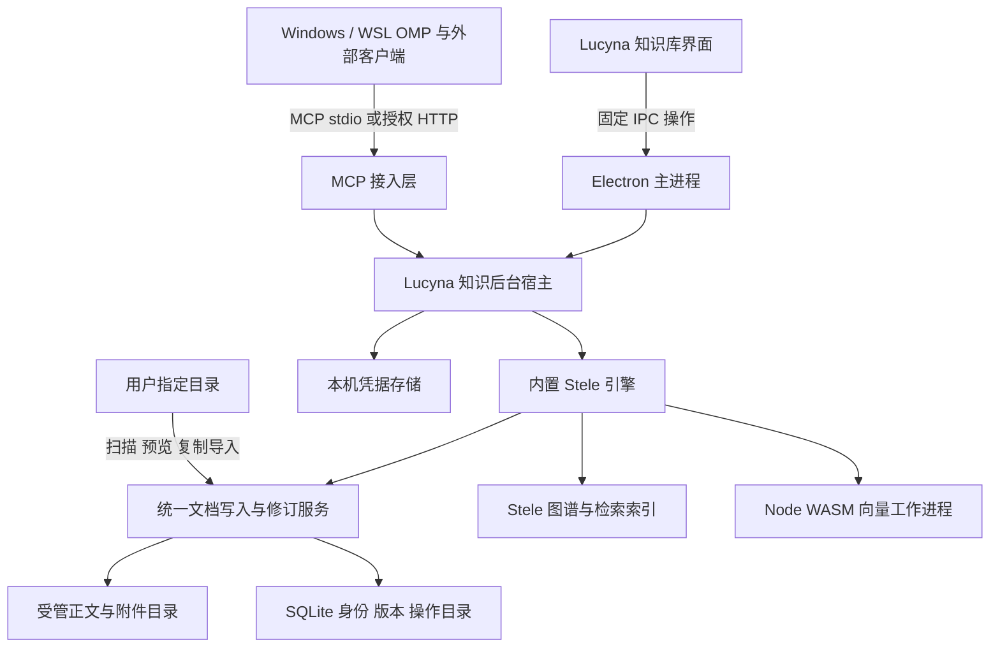

# Lucyna 内置知识引擎与 MCP 服务设计

日期：2026-11-01。状态：M0/M1 的内置引擎、MCP、内部文档和文件夹导入闭环已实现，实际范围见 [内置知识引擎与内部知识库](knowledge-managed-engine.md)。本文保留完整目标；其余能力仍按后续阶段推进。

目标是让 Lucyna 自带 Stele 引擎与 MCP 服务，知识正文进入 Lucyna 管理的数据目录，同时允许导入用户指定路径的知识库。沿用现有知识库面板、Cindy 组件和四套主题，继续由 Stele 提供检索、图谱、证据、候选、复核与知识语义。

推荐采用 **Windows 原生 Stele 进程 + Lucyna 后台宿主 + 受管文档目录 + SQLite 元数据目录**。正文保持 Markdown 和附件文件，数据库保存身份、来源、修订和操作状态；Stele 的索引与向量仍是可重建的派生数据。这样既能实现内部管理，也能复用现有 Stele 文件接口与 MCP 工具。

## 1 交付目标与现状

完整交付应满足：

1. 新用户安装 Lucyna 后，不另装 Stele、Bun 或 WSL，也能使用知识库和 MCP；模型生成功能仍需配置模型服务。
2. UI、Windows OMP、WSL OMP 和外部 MCP 客户端访问同一知识服务实例与文档修订。
3. 导入指定文件夹后，关闭原文件夹、移动原目录或重启电脑，不影响已导入的受管文档。
4. 来源、编辑、审核、删除、恢复、分享和同步均可在 Lucyna 完成；原 Stele 网页不再是完成操作的必经入口。
5. 失败、中断、冲突和降级状态可以核对、恢复；接口存在与业务完成分别验收。

本次核对基于 Lucyna `dee4056` 及本机 Stele 源码。现有 Lucyna 已接真实接口，核心实现为 `src/knowledge-service.cjs`、`KnowledgeWorkspace.tsx` 和 `components/knowledge/`。目前引擎仍在外部运行，HTTP 与多处 MCP 调用固定使用本机 18989 端口。

Stele 本机源码包含尚未提交的扩展。因此发布依赖必须记录完整源码和补丁的摘要，不能只记录其 Git HEAD，也不能直接把开发者当前二进制当成可复现发行包。

## 2 功能覆盖与缺口

“完整”以选定 Stele 版本的 HTTP、MCP、原生面板用户任务为基准。建立能力清单，每项记录 UI 入口、主进程操作、引擎接口、数据所有者、错误状态和真实验收。不同入口可复用 Lucyna 已有页面，但必须有可完成的操作路径。

| 能力 | 当前状态 | 补齐方案与主要接口 |
| --- | --- | --- |
| 文档、图谱、证据、候选、复核、待办 | 已接真实后端 | 迁入受管文档后保留现有流程，统一稳定身份与版本校验 |
| 文档与附件存储 | 主要依赖外部注册目录 | 新建内部知识库、受管正文、附件、修订；默认复制导入文件夹 |
| 引擎和 MCP 生命周期 | 外部运行、固定端口 | 内置运行包、后台宿主、健康握手、实例锁、版本与数据迁移 |
| 文件夹和现有 Stele 导入 | 有单文件资料捕获及目录登记 | 增加扫描预览、批量复制、链接与身份映射、增量再导入、迁移日志 |
| 收藏 | 缺少完整入口 | 文档工具栏星标、文档库收藏筛选；复用 `/api/bookmarks` 并补稳定身份映射 |
| 最近变更与工程洞察 | 没有完整接入 | 探索页增加“最近变更”“工程洞察”；接 `/api/wiki/recent`、`/api/wiki/insights`，展示证据和规则来源 |
| 会话全文与片段检索 | 有会话摘要、关系和时间线 | 接 `/api/wiki/sessions/search`、`session/search`、`session/passages`、`sessions/refresh`；支持命中和上下文定位 |
| 质量检查和死链修复 | 有复核流程，缺修复操作 | 维护页接 `/api/wiki/lint`；预览修复差异后调用版本化修复操作，复用 `fix-dead-links` 语义 |
| 文档批量移除与恢复 | 缺少界面和恢复闭环 | 文档库多选、影响预览、回收站、恢复；原 `/api/wiki/delete` 已有回收语义，但需补持久结果、版本和恢复接口 |
| 来源管理 | 能添加和修改目的 | 增加改名、解绑、重新定位及移除来源；`DELETE /api/workspaces` 只解除登记，不删除用户文件 |
| 报告 | 能生成、列表和阅读 | 增加删除、覆盖范围、跳过/截断来源说明；接报告 DELETE；读取摘要缓存 `/api/wiki/summary`，避免浏览触发重新生成 |
| 文档问答 | 已有 SSE、历史和证据引用 | 当前 `context_files=[]`、`includeGraph=false`；补关联文档选择、图谱上下文开关，说明实际提供的范围 |
| 模型配置 | 仅配置任务模型和 provider 选择 | 补 provider 地址、凭据、默认模型、上下文预算及连接测试；与 OMP、辅助模型配置保持独立 |
| 变更推送 | 以可见时轮询为主 | 接 `/api/wiki/events`；按事件刷新受影响视图，断线重连后核对快照，轮询仅作兼容回退 |
| 分享 | 缺少入口 | 文档分享、有效期、活动链接列表和撤销；接 `/api/share/create`、`list`、`revoke`，分享监听与内部 API 分开 |
| 备份恢复 | 已接 Stele 恢复包 | 现有恢复包仅覆盖配置、工作区登记、claims、review、chat，不能当成完整知识库备份；补正文、附件及其他状态 |
| 同步 | 尚未接入完整数据模型 | 由 Lucyna 同步受管数据的版本、对象和删除记录；不直接启用 Stele 原生镜像写回 |
| Work 与流程视图 | Lucyna 已有 Work/Git 能力，非 Stele 等价覆盖 | 将 `/api/works`、`workflow/artifact`、`changes` 和 change detail 映射至 Work 详情；变更阶段操作沿用原生 guard，缺依赖时显示不可用原因 |
| MCP 工具与权限 | 已有受限 Work/Stele 桥接 | 内置原生 Stele 工具发现与调用；保持 Work 工具在对应执行主机运行，按客户端授权读写能力 |

仅增加 HTTP 转发不能完成上表。例如会话搜索还需要命中定位，删除还需要恢复，分享还需要可访问的发布地址，同步还需要冲突处理。

## 3 推荐架构



后台宿主使用已随应用分发的 Electron 运行时，提供无窗口服务模式。前台 UI 关闭后，已有 MCP 客户端或显式后台任务仍可持有服务租约；无需为了知识服务显示另一个 Stele 窗口。

业务仍通过 Stele 原生 API/MCP 执行。接入层负责实例解析、认证、配额、稳定身份和版本转换，不复制一套检索、候选或图谱算法。

### 路线比较

| 路线 | 优点 | 代价 | 结论 |
| --- | --- | --- | --- |
| 只托管现有 WSL Stele | 可快速复用当前运行环境 | 新安装仍需 WSL；数据和后台生命周期继续跨环境 | 保留为迁移期间的兼容连接 |
| Windows 原生 Stele 与 Lucyna 后台宿主 | 符合安装即用、内部数据和内置 MCP 目标 | 需要向量工作进程、路径、MCP 桥接及打包验证 | 主路线 |
| 在 Electron 中重写 Stele 或把全部正文塞入 SQL | 单一进程或单一数据库外观 | 重写索引、文件引用、MCP 和审核语义，后续维护两套知识系统 | 不采用 |

### 消除 Bun 和源代码目录依赖

当前 `wiki/embed.go` 执行 `bun scripts/embed.ts`。脚本只是读取 JSON、调用 `@ternlight/base` 并输出向量；已安装包提供 Node 接口，模型和 tokenizer 在 WASM 内，不依赖运行时下载。

推荐将同一包和 WASM 纳入运行制品，以 Electron `utilityProcess` 执行 Node 包装器。Stele 通过可配置的 embedding transport 调用工作进程，继续使用相同语义投影、维度和缓存输入版本。不能直接假定旧缓存跨实现兼容：先比较同一批中文、英文、代码混合输入的向量与排序；不兼容则重建。

WASM 和包装器放在明确的资源路径，不依赖开发目录或全局 npm 包。工作进程采用有界队列和分批索引，查询与全库重建有不同优先级；支持超时、取消和失败重启，不能让一次重建长时间堵塞所有查询。

这样终端用户无需安装 Bun。Bun 独立可执行文件可作为包装器无法适配时的备选，但不作为主路线的额外运行时。Electron 的工作进程机制见 [utilityProcess](https://www.electronjs.org/docs/latest/api/utility-process)，Bun 备选制品机制见 [独立可执行文件](https://bun.sh/docs/bundler/executables)。

## 4 内部数据与唯一写入者

推荐目录如下，根路径由现有 `app-identity.cjs` / `data-root.cjs` 解析，不拼接固定 AppData 地址：

```text
<Lucyna userData>/knowledge/
  catalog.sqlite                         # 库、文档身份、来源、修订、操作日志
  libraries/<libraryId>/documents/        # 当前 Markdown 正文，保留目录与相对链接
  libraries/<libraryId>/attachments/      # 图片、原始 PDF/Office 等附件
  revisions/<documentId>/<revisionId>/    # 不可变历史正文与附件清单
  engine-state/                           # Stele 原生业务状态与可重建缓存
  imports/<jobId>/                        # 扫描、暂存、逐项结果及身份映射
  trash/                                 # 回收记录与恢复所需版本
  snapshots/                             # 一致性备份与升级前快照
```

模型凭据与连接令牌存放在本机保护的配置中，不进入可移植知识库、同步对象或普通日志。SQLite 库只在 Windows 本机打开，WSL、SSH 和 MCP 客户端通过服务访问，不直接共享数据库文件。SQLite WAL 要求同主机共享状态，不适合网络文件系统，见 [SQLite WAL](https://sqlite.org/wal.html)。

数据库主要对象：

| 对象 | 核心字段与含义 |
| --- | --- |
| Library | `libraryId`、名称、schema、当前修订；不以目录或显示别名作身份 |
| Document | `documentId`、`libraryId`、相对路径、当前修订、类型、回收状态 |
| Revision | `revisionId`、父修订、内容摘要、附件清单、时间、操作来源 |
| Origin | 导入任务、原文件身份、原始位置、本次来源摘要、最后导入修订 |
| Binding | 本机/WSL/SSH 的位置绑定；不作为跨设备同步的绝对路径 |
| Operation | `operationId`、输入修订、准备/写入/完成状态、逐项结果 |
| Tombstone | 删除对象、删除修订、保留策略和恢复记录 |

正文和附件是内容载体；数据库保存其身份、修订指针和索引目录。内容相同可以去重存储，不能因此把两个不同来源的文档合成同一个事实来源。标题、路径变化不改变 `documentId`。

稳定身份与 Stele 现有路径型 component ID 保留显式映射。内部 API/MCP 边界按版本化 schema 转换结构化身份和引用，原索引可先继续使用本机规范路径；不能全局字符串替换正文，或只改顶层 id 却漏掉证据、待办和候选中的嵌套引用。

### 写入一致性

SQLite 与文件系统没有天然的跨介质事务。采用持久操作日志和可恢复状态机：校验输入修订 → 记录准备操作 → 写入并校验不可变版本 → 提交数据库修订指针 → 原子替换当前文件投影 → 记录完成并发布索引事件。崩溃后根据操作阶段恢复投影或保留原版本，不盲目重发写入。

必须给 Stele 增加受管 `DocumentStore` 边界，使正文编辑、候选采纳、死链修复、删除及 MCP 正文写入走同一写入服务。只让 UI 写数据库、让 MCP 继续直接改文件，会产生两套状态，不能作为交付实现。索引只读取已提交的修订/投影；凭据、业务状态及索引缓存继续由对应原生模块管理，备份时统一协调。

SQLite 放在引擎侧，由同一个服务进程管理。Go 驱动建议优先验证不依赖 CGo 的 `modernc.org/sqlite`，其官方平台表包含 Windows；固定 Go/SQLite/驱动及关联依赖版本后再纳入制品，不能直接浮动使用最新版，见 [驱动文档](https://pkg.go.dev/modernc.org/sqlite)。

现有 Work 资料与证据包设计中的 `workId`、来源引用和快照可绑定 `libraryId/documentId/revisionId`。Git 仓库与正在执行的 OMP journal 保持其运行时边界，不为了内部知识库自动搬迁活动工作树。

## 5 自定义路径导入

### 默认复制导入

流程为：**选择目录 → 选择目标知识库 → 扫描预览 → 确认范围 → 分批导入 → 索引 → 查看结果**。

- 通过原生目录选择器登记来源，支持 Windows 文件夹及可访问的 WSL 路径。SSH 来源复用已有主机文件读取能力，作为后续导入适配器，不把远端绝对路径当本地路径。
- Markdown 保留相对目录、frontmatter、文内链接和本地图片/附件。支持纯文档树及 Stele 已支持的 OpenSpec、Trellis、Superpowers 布局，不把所有来源强制降为普通 docs。
- PDF、Office、文本和网页复用资料捕获/提取能力，保留原件与抽取正文的关系。导入文件夹不等于支持目录内任意格式；扫描结果列出不支持、超限和提取失败项。
- 默认排除 `.git`、运行缓存和凭据文件；符号链接、目录联接、大小写冲突、重复规范路径和跨根附件在扫描时给出明确结果，不悄悄越出所选范围。
- 同名与同内容分别处理：相同来源且未变化则跳过；原文变化则生成待核对修订；不同来源同名可保留两篇或重命名。不得直接覆盖本地已编辑的文档。
- 文件上传的现有 10 MiB、快照 2 MiB 等限制目前不一致。实施时统一为按格式和操作定义的预算，并在扫描阶段预检，不在复制完成后才丢弃正文。
- 任务支持暂停、继续、取消和失败项重试。取消不删除已经提交的文档；报告成功、跳过、失败及待索引数量。

导入成功的判据是内容已进入内部目录且能重开阅读；语义索引完成另记状态。导入行为本身不代表内容经过事实审核，也不自动采纳成已验证知识。

### 再导入与关联目录

再次导入保留“上次导入版本、内部当前版本、外部当前版本”三个基准：只有一侧改变可生成明确更新；两侧均改变则展示冲突。外部文件消失默认标记来源失联，不自动删除内部文档。

可选的“关联外部目录”应单独命名，默认只读索引；它是兼容模式，外部文件移动后可能不可用，不宣称已经转移到内部。解除关联保留外部原件。首个交付优先完成复制导入，不让关联模式拖延内部存储闭环。

## 6 内置服务与 MCP

### 生命周期

后台宿主按用户和 profile 管理单实例，使用受保护的本机控制通道。状态至少包括：未准备、启动中、索引中、就绪、部分能力不可用、升级中、停止中、故障。

无窗口服务与 MCP 启动参数在 GUI 单实例和 renderer 初始化之前分流，使用独立的服务实例锁；后台宿主不打开界面草稿数据库，避免与前台争用浏览器 profile。

引擎新增 `/api/health` 与 `/api/capabilities` 契约，分别返回实例身份、构建摘要、存储 schema、索引状态、embedding 状态和能力列表。应用不能把端口可连接或 HTTP 200 当成知识可用。UI 根据能力显示具体降级，例如“可阅读，语义索引正在重建”。

运行包使用绝对路径启动并隐藏辅助控制台，校验制品摘要；发现旧 18989 服务时只作为外部兼容连接，不抢占、结束或覆盖用户服务。前台界面和多个 MCP 客户端复用一个后台实例，不各自启动索引器。

关闭 UI 与完全退出服务分开。默认在仍有 MCP 连接或后台任务租约时维持服务；无租约后按空闲策略退出。开机常驻作为明确设置；不把当前客户端在线验证描述为已通过冷启动验收。升级等待活动写入完成，保留旧制品和数据快照；schema 变更后的回退必须恢复匹配的数据快照，不能只换回 exe。

### MCP 接入

提供两种入口，均路由到同一 Stele 实例：

| 入口 | 使用方式 | 数据与权限 |
| --- | --- | --- |
| MCP stdio | 发布受支持的 Lucyna MCP 启动命令，可在没有 UI 窗口时连接/启动后台宿主 | 客户端配置绑定 profile、知识库和读写范围；令牌由本机宿主取得 |
| MCP HTTP | 本机回环地址与受保护连接配置；复用 Stele `/mcp` | 认证和能力范围一致，不把管理 API 发布到局域网 |

沿用 Stele 工具发现与 schema，包括 wiki 检索、读取、关系、上下文、claim、复核和 todo。新接入层补稳定文档 URI 与旧路径映射，不向客户端分发数据库访问权限；MCP 资源和提示能力仅在原生引擎实际支持或完成扩展后宣称支持。

WSL 不能继续硬编码它自己的 `localhost:18989`。优先以 Windows MCP stdio 入口桥接同一服务，验证 WSL 互操作及 Work Runner 的 systemd 环境。若该后台环境无法可靠互操作，需要实现可验证的用户级桥接通道；此项未通过前不切换现有 WSL 调用，也不宣称全部客户端已统一。

必须同时修改 `backend.cjs`、`tools/work-stele/server.py` 和 `tools/work-runner/capabilities.py` 的服务解析。Work helper 和工作区操作仍在所属主机执行；知识调用转向所选库。远端 SSH 主机默认不继承本机知识库或凭据，需显式绑定。

## 7 补齐功能的交互与写入契约

现有“文档、资料来源、探索、维护、待办与报告”结构保留；功能归入现有分组，不新增另一套全屏知识应用。

| 位置 | 新增交互 |
| --- | --- |
| 文档库 | 收藏筛选、多选、移动/重命名、回收站；正文工具栏增加收藏和分享 |
| 资料来源 | 新建内部库、导入文件夹、导入任务、来源更新；复制导入与关联目录分开描述 |
| 探索 | 最近变更、工程洞察、会话正文搜索；搜索结果可跳至上下文与来源版本 |
| 维护 | 质量规则筛选、死链修复 diff、批量处理结果、恢复入口 |
| 设置 | 知识库与存储、模型服务、同步、分享与连接、引擎版本及诊断 |

宽窗沿用列表和阅读器；窄窗渐进切换，返回保留选择与位置。重要状态除颜色外有文字。四主题及深浅模式共用行为；键盘多选、对话框焦点、取消回焦、长路径和长标题纳入验收。本轮只确定这些交互契约，不重做视觉主题。

新增写操作统一接受 `operationId`、目标稳定身份和输入修订，返回逐项结果。删除、修复及覆盖提供具体影响预览；后端在执行点再次校验。传输中断后先查询操作结果，不能自动重复删除、生成、分享或同步。

当前死链修复请求只有 sourceId/oldPath/newPath，缺少强输入版本；批量删除也未形成可查询的完整恢复契约。需补引擎端版本化预览/执行/恢复，不以“主进程先检查一次，再调用旧接口”代替执行点校验。

会话片段定位记录规范会话身份、来源修订和 seq；UTF-8 字节位置转换为前端字符位置后再高亮，不能直接把 byteOffset 当 JavaScript 字符下标。遇到来源变化重新定位，保留原查询。

问答多文档上下文先解析为当前库内的受限文档身份，再交给 Stele；渲染器不能提交任意文件路径。显示实际选入的文档和图谱范围，不将检索命中自动标为结论成立。

模型设置继续使用 Stele 的 provider 和任务模型语义。新增地址、默认模型、参数和测试入口；凭据只写入本机保护存储，经受限宿主通道交给引擎的内存 SecretResolver，不落成可同步的明文配置。Windows 存储可复用系统保护机制，见 [Electron safeStorage](https://www.electronjs.org/docs/latest/api/safe-storage)；应按实际打包版本选择受支持 API，并验证无窗口宿主可解密。

## 8 分享 同步与完整备份

### 分享

复用 Stele 独立的 share-only 监听器；内部管理 API 始终留在本机。UI 提供范围预览、到期时间、复制地址、活动列表和撤销。默认分享固定修订，跟随当前文档更新须明确选择；实现时扩展原生按路径读取语义，不能把实时内容冒充固定快照。

只有发布地址及访问探测成功才显示“可供其他设备访问”。仅生成 localhost URL 时显示“本机可用”，不能当公开分享成功。用户可配置已有 HTTPS 入口；本阶段不自动开防火墙或部署公网服务器。回收文档时核对并撤销关联分享。

### 同步

同步对象为受管知识正文、附件、修订、收藏、待办及可移植业务记录；Work 资料和证据包通过稳定 `workId` 挂接。原生 OMP 活跃 journal、工作树、凭据、本机路径、向量缓存和分享令牌不直接合并。

使用对象摘要、修订父关系和 tombstone 构建可移植清单，Git 或自托管服务仅作为传输后端。不直接同步 `catalog.sqlite`、WAL 或 Stele 运行目录。无冲突更新可应用；同一正文的并发编辑进入三方差异；正文修改与另一端删除冲突时保留恢复入口，禁止最后写入者静默覆盖。

Stele 现有 `POST /api/sync` 会将 knowledge mirror 写回来源目录，且现有实现并不等于 Lucyna 全状态同步。它只作为旧数据迁出/兼容能力分析，不直接绑定到新的“同步”按钮。源代码仓库 remote 不作为用户知识同步目的地；目标由同步设置明确指定。

### 备份与恢复

保留现有 Stele 恢复包的兼容导入，另定义完整 Lucyna 知识包，包含：数据库一致性快照、正文与附件、修订及回收清单、claims/reviews/chat/todos/bookmarks/reports 等业务状态、schema 和内容摘要。默认排除凭据、连接令牌、临时锁与可重建索引。

数据库快照通过一致性备份能力生成，文件按快照中的不可变清单收集；不直接复制活动数据库文件。SQLite 提供 [在线备份 API](https://sqlite.org/backup.html)。恢复先导入隔离目录，验证摘要、路径、版本与空间，展示冲突后切换；不可逆 schema 变更有对应回退包。

## 9 现有 WSL 数据迁移

迁移采用复制导入：发现已有实例 → 预检清单 → 获取稳定状态 → 复制到暂存区 → 验证正文和附件 → 转换身份与业务引用 → 重建索引 → 核对 → 切换默认服务。

1. 原 WSL 文档和配置保留。活跃写入时不宣称全库一致快照；先安排写入静默窗口或增加原生快照支持。
2. 建立旧实例、workspace、绝对路径到 `libraryId/documentId` 的映射，覆盖 Markdown 链接、证据、claim、候选、待办、收藏、会话引用和按身份散列的 chat 存储。
3. 原样保留可迁移的原文版本及出处；不能仅改绝对路径就把历史证据标为当前有效。需重验的证据明确标记。
4. 模型凭据单独在本机配置，不混入普通迁移包。已有 Stele 恢复包还要补正文、附件及未覆盖业务状态，不能只上传 ZIP 就宣布迁完。
5. 分别验收 UI、Windows MCP、WSL MCP 和后台 Runner 后再改默认绑定；出错可恢复旧连接，旧数据不被自动删除。

## 10 模块划分与开发顺序

| 模块 | 建议位置与职责 |
| --- | --- |
| 运行制品 | `resources/knowledge-engine/` 与构建脚本；固定源码、补丁、WASM、协议及许可证摘要 |
| 后台宿主 | `src/knowledge-runtime.cjs`；无窗口启动、实例锁、连接配置、租约、升级及诊断 |
| 前端适配器 | 扩展 `knowledge-service.cjs`；按实例解析、固定操作、事件、输入校验和错误映射 |
| 引擎扩展 | 可审计的 Stele 补丁集；LibraryStore、DocumentStore、capabilities、版本化操作和恢复 |
| 向量工作进程 | `src/knowledge-embedding/`；复用 Node WASM 包，隔离 CPU 工作与协议处理 |
| 导入与迁移 | 引擎侧持久导入任务；主进程提供受限目录选择和来源读取适配 |
| MCP | 无窗口入口与现有 Work/Runner 桥接改造；复用原生工具定义 |
| 界面 | 扩展现有 `components/knowledge/`；增加收藏、搜索、维护、来源及设置视图 |
| 验收清单 | 机器可读能力矩阵及原生隔离夹具；跟随固定 Stele 版本维护 |

优先做一个可安装的纵向闭环，再补入口数量：

| 阶段 | 交付物 | 完成门槛 |
| --- | --- | --- |
| M0 原生化验证 | 固定 Stele 扩展源码；Windows 引擎；Node WASM worker；stdio MCP 和后台宿主原型 | 无 WSL/Bun/开发目录时可建索引、语义检索、读写与问答；旧/新向量结果差异可解释 |
| M1 内部数据闭环 | 内部库、SQLite 目录、受管版本、文件夹复制导入、原生 MCP 共用写入 | 导入 → 阅读 → 编辑 → MCP 查询/写入 → 重启 → 回看版本全程一致；崩溃点可恢复 |
| M2 功能补齐 | 收藏、近期、洞察、会话片段、质量修复、回收恢复、来源解绑、报告删除、完整上下文和事件 | 覆盖表中每项有正式 UI 操作和真实接口验收；不依赖原 Stele 网页 |
| M3 迁移与运维 | WSL 迁移、全部客户端切换、模型凭据、完整备份、升级回退、分享 | 数据及引用对账通过；新装与升级两条路径通过；分享可访问/过期/撤销符合显示 |
| M4 跨设备同步 | 对象与修订传输、第二设备绑定、冲突和删除恢复、Work 资料关联 | 两台设备离线修改后可核对合并；绝对路径与凭据不串入；不修改活跃工作树或 journal |

M0 的试验代码只证明原生化可行，M1 才形成用户明确要求的“引擎和 MCP 内置、文档内部管理、自定义路径导入”闭环。M2–M4 完成后再使用“选定版本的 Stele 功能完整覆盖”的表述。

## 11 验收与发布条件

| 场景 | 必须看到的结果 |
| --- | --- |
| 干净 Windows 安装 | 不装 WSL、Go、Node 或 Bun，仍能导入文件夹、索引并通过 MCP 读取 |
| 路径与附件 | 中文、空格、长路径、大小写冲突、相对图片、文内链接和跨根引用结果明确 |
| 导入再导入 | 同源未变跳过；两边修改显示冲突；移走源目录后内部副本仍可读 |
| UI 与 MCP 并发 | 相同修订只接受兼容写入；冲突保留编辑；重复 operationId 返回同一结果 |
| 崩溃与磁盘失败 | 在版本写入、数据库提交、投影替换、删除、恢复各阶段中断，重启后可核对 |
| 多进程与端口占用 | 复用正确实例；不连接错库，不结束已有外部 Stele，不启动重复索引器 |
| WSL 与后台 Runner | 从实际 systemd 环境访问同一库，UI 关闭后的服务租约行为符合说明 |
| 完整备份 | 新 profile 恢复后正文、附件、历史业务状态与引用可核对；凭据需单独配置 |
| 分享与同步 | 地址真实可达；过期撤销生效；离线编辑、删除冲突、连接中断可恢复 |
| 视觉与性能 | 四主题深浅模式、960/375 窄窗、键盘流程及草稿/位置保留；按真实规模测量导入和索引，不以空库速度代表大库 |

现有 `test/knowledge-native-desktop.cjs` 与独立 Stele 夹具继续使用，但增加“安装包内置引擎、内部库、MCP 客户端、迁移及恢复”层。离线协议夹具通过不代表真实模型质量，也不代表所有运行环境已支持。

正式发布保留功能矩阵、制品构建记录、迁移对账、失败恢复结果和许可清单。本文只完成方案设计，没有迁移现有数据、修改运行中的 Stele 或启用同步/公开分享。
